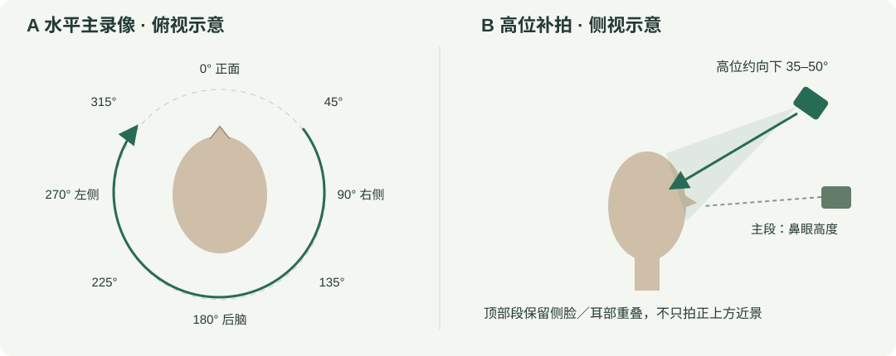

# 摄像头与拍摄视角

## 用什么摄像头

| 用途 | 设备 | 本项目情况 |
|---|---|---|
| RGB-D 真人重建 | **Orbbec Gemini 2** | 开发期间两组真人实验实际使用的设备；Windows SDK 1.8.3 桥接 |
| 练习采集与实验性 RGB 重建 | 电脑内置摄像头或稳定的普通 RGB 相机 | 可录制两段普通视频；没有实测深度、可靠绝对尺寸，质量更依赖拍摄条件 |
| 仅查看发型演示 | 不需要摄像头 | 直接运行 `main.py` |
| 其他深度相机 | 视具体 SDK／录像格式而定 | 未实现通用深度相机接口，不保证可直接读取其录像 |

Gemini 2 的官方规格为主动双目红外、USB 3.0，最高深度 1280×800 @30 FPS、RGB 1920×1080 @30 FPS；来源：[Orbbec 官方产品页](https://www.orbbec.com/products/structured-light-camera/gemini-2/)。本项目两次实际采集记录与这两个分辨率／帧率配置一致。此处没有公开设备序列号或标定文件。

请保存原始 `.bag` 和同次采集的配套信息。普通视频或深度预览的彩色录屏不能替代原始深度数据；MP4 不会自动变成 RGB-D 输入。

## 推荐拍摄布置

以下距离、角度与时长是本项目的经验性起点，不是相机厂家保证的最佳扫描参数。

- 稳定室内漫射光，避免直射日光、强反光、逆光和脸部大面积阴影；背景简单，不让其他人的脸进入画面。
- 用 USB 3.0 数据线直接连接电脑，固定相机。先试录约 5 秒，确认彩色与深度都有内容，文件能正常结束并回放。
- 相机与头部可从约 **0.6–0.9 米**开始调整：完整头顶、耳朵、下巴及一小段颈部都要入镜，并留出转动余量。实际以有效深度覆盖和构图为准，不要把相机最近量程当成人头扫描推荐距离。
- 摘耳机、帽子和遮住耳朵的饰物。眼镜可能反光并遮挡鼻梁／眼周；可先设置倒计时、用提示音辅助摘镜拍摄，再单独拍一小段戴镜外观参考。无法摘镜时记录该遮挡，不承诺眼周完整。
- 保持自然闭口、中性表情，不说话、不大幅眨眼或鼓腮。使用转椅或缓慢转动身体，尽量不让头部相对身体不断扭动。

## 至少两段：水平主录像＋顶部补拍



### A：水平一圈，约 45–60 秒

相机接近鼻眼高度。正面停 2–3 秒后缓慢转完整一圈，连续覆盖：

**正面 0° → 右前 45° → 右侧 90° → 右后 135° → 后脑 180° → 左后 225° → 左侧 270° → 左前 315° → 回正面。**

左右以被拍者的自身方向理解。每个主要区域可短暂停留约 2 秒，转动过程仍连续保留。相机固定、身体转动与绕人移动相机二者择一，避免同时转人和移动相机。

必须看见两只耳朵的前后轮廓、两侧鬓角、后脑和后颈发际线。左右各看一下但没有后脑，不算完整一圈。

### B：高位斜拍，约 30–45 秒

将相机升高，约 **向下 35–50°** 斜拍，保持脸部上半部、耳朵及侧后区与 A 段有共同可见区域。保持头部自然姿态，再缓慢转一圈，覆盖头旋、两侧顶部和后上部。

不要只从正上方对着黑发拍一个近景：没有与 A 段重叠的特征时，顶部素材可能无法配准。顶部 RGB 清楚也不代表黑发处有有效深度。

## 拍完先检查什么

1. 两段都是同一种输入：两段 Gemini BAG，或同一相机／相同分辨率的两段 RGB 视频。
2. 正面、左右侧、后脑和头顶均有清楚覆盖；转动时耳朵和头顶没有离开画面。
3. 播放深度时，顶部不是整片空洞／零深度；后脑没有被椅背和衣领遮住。
4. 没有明显运动模糊、表情变化、突然曝光跳变或摇晃。
5. 顶部段确实包含高位斜视角，并与主段重叠；标签和实际内容一致。
6. 正常停止录制，文件可回放；备份原始素材后再运行重建。

好处是有不同且有效的视角，不是单纯录更久。开发中的一组结果使用 113 主视角＋106 顶部视角；另一组仅融合 20 个顶部视角，原始顶部仍有缺口。即使有顶部段，深度缺失、遮挡或配准失败仍会留下孔洞。

## 从拍摄到运行

采集器入口是 `rgbd_capture/gemini_capture.py` 或 `head_capture/capture.py`。程序不会因启动演示而自动开镜头；先安装 [重建资源](RECONSTRUCTION.md)，再启动采集器。

```powershell
python main.py --reconstruct --primary "D:\my_capture\main.bag" --top "D:\my_capture\top.bag" --check
python main.py --reconstruct --primary "D:\my_capture\main.bag" --top "D:\my_capture\top.bag"
```

文件位置是示例，替换成自己的输入路径。RGB 视频使用同样参数指定两段视频；不能把 RGB 结果描述为相机实测深度。
