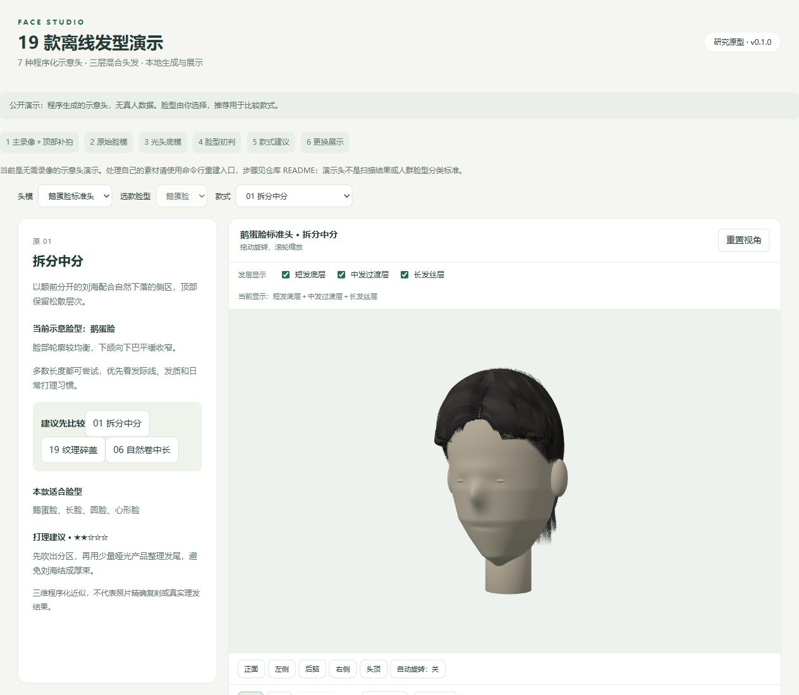
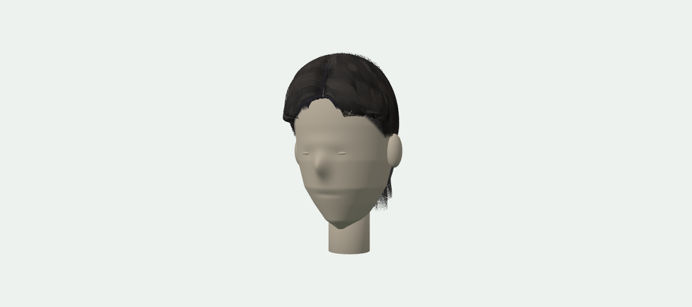

# 效果实例

## 三维试戴界面

示意头由程序生成，五官经过简化。短发底层、中发过渡和长发丝共同构成款式；可以独立开关，也可以旋转至侧面、后脑和头顶检查。

## 实际 PNG 导出

图片来自页面实际渲染，可以在本机重新生成。它展示程序化发型外观，不是相机测量得到的真实头发。

## 真人重建实验

项目曾完成两组 Gemini 2 真人重建：一组融合 113 个主视角与 106 个顶部视角；另一组融合 113 个主视角与 20 个顶部视角，原始顶部仍有缺口。有效视角数量不等于重建精度。

录像、人脸网格和皮肤纹理由使用者本地管理，仓库不提供参与者数据。使用自己的素材可按 [采集指南](CAPTURE_GUIDE.md) 和 [重建设置](RECONSTRUCTION.md) 运行实验。

## 制作展示图

推荐固定光照、头部比例、发色与视角，分别渲染正面、侧面和顶部，比较同一头模上的不同款式。需要更完整的五官时，参考 [标准头获取与适配](STANDARD_HEADS.md)。展示真人结果前应确认被拍摄者同意相应的使用范围。
